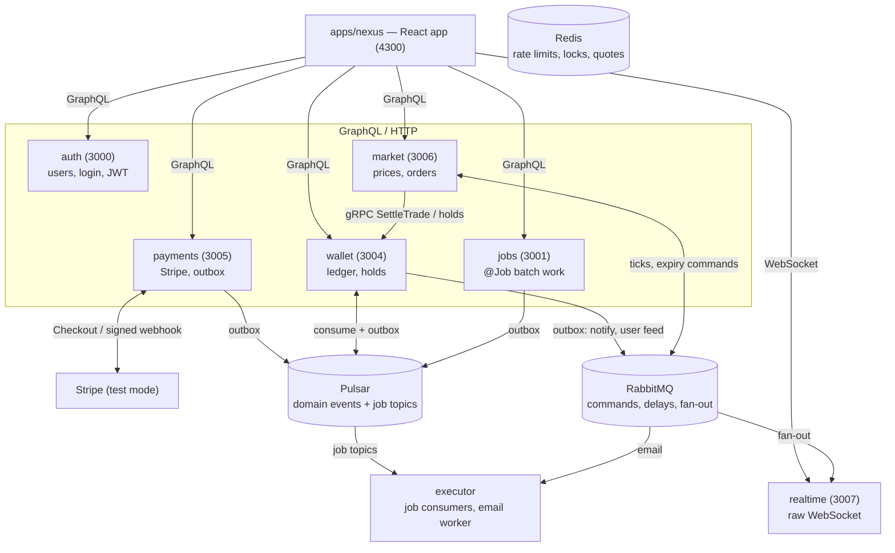
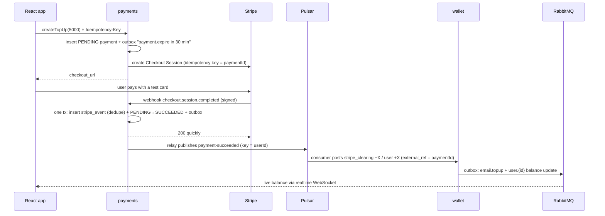

# Purpose and architecture

## Why this project exists

NexusPay is a pet project for learning the hard parts of payment systems, not for shipping a
product. Payments are a good teacher because mistakes are visible: a message processed twice
credits a wallet twice, a crash between two writes loses money, a race overdraws an account. The
project is built so that each of those failure modes is designed for, then proven with a test.

Learning goals, in priority order:

1. **Money correctness** — a double-entry ledger, holds, reconciliation.
2. **Idempotency at every layer** — API requests, outgoing provider calls, incoming webhooks,
   message consumers.
3. **The transactional outbox** — never lose a message, never send one for a change that didn't
   commit.
4. **Two brokers, each for what it is good at** — Pulsar for durable events, RabbitMQ for commands,
   delays and fan-out.
5. **Observability** — one trace per business operation across services and brokers.
6. **New frontend tools** — React 19, TanStack Router and Query, raw WebSockets.

It is built **inside the existing jobber monorepo** and reuses what already works there: `auth`
(cookie JWT + gRPC `Authenticate`), the gRPC contracts, the Pulsar library, GraphQL, Drizzle, the
`@Job` framework and the Helm chart. Nothing that already works is rebuilt just to learn a new
tool; Keycloak, Traefik and Kysely were considered and skipped on purpose (see the end).

**Out of scope:** real money, real coins, KYC/AML, a real order-book matching engine, payouts to
a bank.

## The product in one paragraph

A user signs up, tops up a USD wallet through Stripe Checkout (test mode), sends money to other
users, and trades a handful of invented coins (NXC, BLIP, ORB, …) on a simulated market whose
prices move every second. Trades fill against a simulated market maker, not other users. Every
balance change is a ledger transaction; every page updates live over a WebSocket.

## Target architecture

Rules that shape everything else:

- **Wallet is the only service that changes balances.** Everyone else asks it over gRPC or by
  event.
- **Database per service** on the shared PostgreSQL instance.
- **Every GraphQL app and the realtime gateway** check the `Authentication` cookie through auth's
  gRPC `Authenticate`, the same way `jobs` already does.
- **GraphQL for request/response, raw WebSockets for live data.**

### Which broker carries what

| Messages | Broker | Why this broker |
| -------- | ------ | --------------- |
| `payment-succeeded`, `transfer-completed`, `trade-executed` | Pulsar | Facts several services read; retention and replay; per-user ordering with Key_Shared |
| Job topics (`Fibonacci`, `LoadProducts`, later `Airdrop`, `Reconcile`, …) | Pulsar | The existing jobs framework |
| `notifications` exchange: `email.topup`, `email.trade`, … | RabbitMQ | A work queue with one consumer, routing by channel, TTL + DLX retries for a flaky mail server |
| Delayed commands: expire unpaid payments (30 min), expire limit orders (24 h) | RabbitMQ | A TTL queue that dead-letters into the `commands` exchange when the command is due |
| `realtime` exchange: `prices.<coin>`, `user.<id>` | RabbitMQ | Each realtime instance binds only the keys its clients need; ticks are non-persistent |

## Money and the ledger

Every money movement is a **balanced journal transaction** of two or more entries. Entries are
append-only: corrections are new reversing transactions, never edits. Amounts are `BIGINT` in each
asset's minor units (cents for USD, 10⁻⁸ for coins) — never floats, never JS numbers on the wire.

| Table | Purpose | Key constraint |
| ----- | ------- | -------------- |
| `assets` | USD and the fake coins, with their scale | USD scale 2, coins scale 8 |
| `accounts` | One row per owner + asset + kind (`available`, `held`, `system`) | `CHECK (balance >= 0)` on user accounts |
| `transactions` | Journal header: type, `external_ref` | `UNIQUE (type, external_ref)` — business idempotency |
| `entries` | Signed amount per account | Sum per transaction per asset = 0 (deferred trigger) |

Example — user 42 buys 0.5 NXC at $40.00 with a 0.5% fee. One transaction, two assets, each
summing to zero:

| Account | Asset | Amount (minor units) |
| ------- | ----- | -------------------- |
| user:42:available | USD | −2010 |
| market_maker | USD | +2000 |
| fees | USD | +10 |
| market_maker | NXC | −50000000 |
| user:42:available | NXC | +50000000 |

Concurrency rule: lock the touched accounts with `SELECT … FOR UPDATE` in ascending id order (no
deadlocks); a violated `CHECK` becomes "insufficient funds". Holds work like card
authorisation/capture: a limit order moves funds `available → held`, then the fill captures them or
a cancel releases them.

## The logic chain of each flow

### Top-up (money in)

Each arrow that can be repeated is safe to repeat: the API call by `Idempotency-Key`, the Stripe
call by its idempotency key, the webhook by `stripe_events.event_id`, the credit by
`transactions(type, external_ref)`.

### Other flows

- **Transfer:** `transfer(toEmail, amount)` locks both accounts in id order, posts two entries,
  and emits `transfer-completed` plus live balance updates for both users.
- **Trade:** a 10-second quote lives in Redis; `placeOrder(quoteId)` consumes it atomically, and
  market calls `wallet.SettleTrade(tradeId)` over gRPC, where `tradeId` makes retries safe. Limit
  orders place a hold and fill when the simulated price crosses the limit.
- **Refund:** hold the amount first, so it fails if the money is already spent; capture on
  `charge.refunded`.
- **Dispute:** can't be refused. Debit what's available, write the shortfall to `dispute_losses`,
  freeze the wallet.
- **Delayed commands:** publish to a per-bucket delay queue (`delay.1m/30m/24h`). When the TTL
  expires the message reaches `commands`, and the owner acts only if the state still allows it.
- **Batch work:** `Airdrop`, `Reconcile`, `LedgerAudit` and `BackfillCandles` are ordinary
  `@Job()`s, so they reuse the jobs framework.

## Reliability patterns

PostgreSQL constraints are always the source of truth. Redis only speeds things up or
coordinates in-flight work; losing Redis must never cause a double credit.

| Layer | Mechanism | Source of truth |
| ----- | --------- | --------------- |
| Client API | `Idempotency-Key` header: store key + request hash + response for 24 h | `idempotency_keys` row (Redis lock only as a fast path) |
| Outgoing Stripe calls | Stripe idempotency key = `paymentId` | Stripe |
| Incoming webhooks | Insert the event id in the same transaction as the state change | `stripe_events UNIQUE (event_id)` |
| gRPC into wallet | Caller passes a business id (`tradeId`, `airdrop:<job>:<index>`) | `transactions UNIQUE (type, external_ref)` |
| Message consumers | Business key, or an inbox row in the same transaction as the effect | Unique constraint |
| Publishing | Transactional outbox + broker dedup by `sequenceId` | `outbox` table |

**Transactional outbox:** a service writes the messages it wants to send into an `outbox` table
*in the same database transaction* as the state change. A background relay publishes them and
marks them sent. A crash can then never leave a change without its message, or a message for a
change that rolled back. A crash between publish and mark resends the message, so delivery is
at-least-once: Pulsar's broker deduplication (by producer name + `sequenceId`) drops the
duplicate, and consumers stay idempotent anyway.

**Reconciliation:** a nightly job matches Stripe's balance transactions against payments and
ledger entries, and asserts that every journal transaction sums to zero and every cached balance
equals the sum of its entries.

## UI: a simulated crypto market

A paper-trading market makes the ledger visible: multi-asset entries, holds, fees and live
balances. Trades fill against a simulated market maker at the mid price ± spread, so no
matching engine is needed.

| Screen | Shows | Exercises |
| ------ | ----- | --------- |
| Wallet | Balances (available/held), top-up, history | Stripe redirect, ledger queries |
| Markets | Coins with live prices | WebSocket stream |
| Trade | Candles, market/limit order form, quote countdown | Quotes, holds, `Idempotency-Key` |
| Portfolio | Value over time, P/L per coin | Read models from entries |
| Send | Transfer by email | Concurrent transfers |
| Ops (admin) | Outbox lag, DLQ depth, recon issues, chaos buttons | The interview demo |

The React app is `apps/nexus` (React 19, Vite, TanStack Router + Query, `graphql-request`, React
Hook Form + Zod, Tailwind). The Angular `ui` app stays the jobber jobs console.

## Skipped on purpose

| Tool | Why it was skipped |
| ---- | ------------------ |
| Keycloak | `auth` already issues cookie JWTs checked over gRPC. Switching means rewriting the guard and the login flow — a week on login, not money. Optional stretch goal. |
| Traefik | The Vite/Angular dev proxies and the Helm ingress already route by path, WebSockets included. |
| Kysely | Drizzle already does `FOR UPDATE`, isolation levels and raw SQL; the learning is the SQL itself. |

## Decisions already taken

| Question | Decision |
| -------- | -------- |
| Max items per job | 10,000; larger uploads are rejected so a job is created in one transaction |
| Wallet creation | Accounts are created lazily on first use; no `openWallet` mutation |
| Top-up limits | $1–$1,000 per payment, at most $2,000 per user per rolling 24 h |
| Market maker runs low on a coin | Refill to 1,000 from a `genesis` system account when below 100 |
| Realtime subscriptions | One `user.<id>` RabbitMQ binding per connected user per instance |
| Unfreezing after a lost dispute | An admin may unfreeze; the shortfall stays written off |
| Fibonacci job size | `iterations` ≤ 1,000 (10,000 already blocks the executor for ~9 s) |
