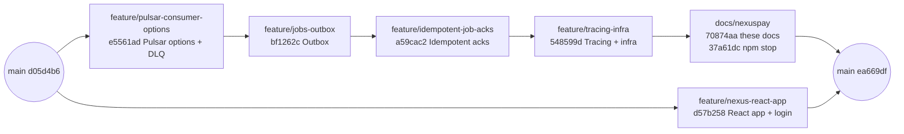

# NexusPay — start here

NexusPay is a learning project built inside the jobber monorepo: a wallet and payments platform
with a simulated ("paper trading") crypto market as its UI. It exists to practise the parts of
backend engineering that matter most when money is involved — a double-entry ledger, idempotency,
the transactional outbox, safe retries and tracing — on top of the services jobber already has.

These documents let anyone (including future you) pick the project up cold and understand both
**what** was built and **why** each decision was made.

## Read in this order

| # | Document | What it answers |
| - | -------- | --------------- |
| 1 | [Purpose and architecture](01-purpose-and-architecture.md) | Why the project exists, the target architecture, the logic chain of every money flow |
| 2 | [Repo guide](02-repo-guide.md) | How the monorepo is laid out, how to run, test and debug it, known gotchas |
| 3 | [Roadmap](03-roadmap.md) | The five phases, what each delivers, the decisions already taken |
| 4 | [Phase 1 — step by step](phase-1/README.md) | What was actually built in phase 1, step by step, and how each step was verified |
| 5 | [React app guide](react-app-guide.md) | How `apps/nexus` is structured and why, layer by layer, with Angular parallels — for learning React |

The full design spec, with detailed per-phase specs (scope, design, tasks, acceptance tests,
risks), lives in Claude Docs:
[NexusPay — Wallet & Payments Pet Project Spec](https://claude.ai/artifact/4YUyyamSZtgiVJcjZYsBko).
These repo docs summarise it; when they disagree, the code and these docs describe what was
actually built, and the spec describes the plan.

## Status

| Phase | Content | State |
| ----- | ------- | ----- |
| 1. Groundwork | Pulsar consumer options + DLQ, transactional outbox, idempotent job acks, tracing + infra, React app with login | **Done** |
| 2. Ledger core | `apps/wallet`, double-entry ledger, transfers, `libs/money`, `libs/idempotency`, Wallet/Send screens | Next |
| 3. Stripe + RabbitMQ | `apps/payments`, Checkout, signed webhooks, `libs/rabbitmq`, email, delayed commands | Planned |
| 4. Market + realtime | `apps/market`, price simulator, orders and holds, `apps/realtime` WebSocket gateway | Planned |
| 5. Hardening | Refunds, disputes, reconciliation, airdrops, rate limits, roles, Ops screen, Helm | Planned |

## Branches (phase 1)

All of phase 1 was merged into `main` on 2026-11-05 (merge commit `ea669df`). The backend work
was a stack of branches, each built on the previous one, so `main` fast-forwarded through them;
the React app was branched separately and came in with a merge commit:

| Order | Branch | Commit | Step |
| ----- | ------ | ------ | ---- |
| 1 | `feature/pulsar-consumer-options` | `e5561ad` | [Step 1 — Pulsar consumer options and dead-lettering](phase-1/01-pulsar-consumer.md) |
| 2 | `feature/jobs-outbox` | `bf1262c` | [Step 2 — Transactional outbox](phase-1/02-outbox.md) |
| 3 | `feature/idempotent-job-acks` | `a59cac2` | [Step 3 — Count each job item once](phase-1/03-idempotent-acks.md) |
| 4 | `feature/tracing-infra` | `548599d` | [Step 4 — Tracing and infrastructure](phase-1/04-tracing-infra.md) |
| 5 | `docs/nexuspay` | `70874aa`, `37a61dc` | These documents; `npm stop` rewritten as `scripts/stop.mjs` |
| 6 | `feature/nexus-react-app` | `d57b258` → merge `ea669df` | [React app with login](phase-1/00-react-app.md) |

The merge had three conflicts: `package.json` (kept `nexus` in `npm start` and the new
`npm stop`), `CLAUDE.md` (combined the intros) and `package-lock.json` (took the React branch's
lock, then ran `npm install --package-lock-only --legacy-peer-deps` to add the backend packages).
Lint, test and build passed for all 13 projects on the merge result.

Phase 2 should start from a fresh branch off `main`.
