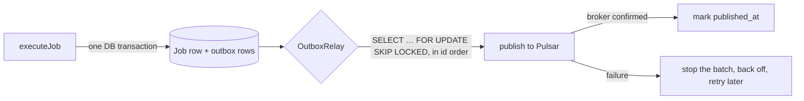

# Step 2 — Transactional outbox

- **Branch:** `feature/jobs-outbox` (commit `bf1262c`), on top of step 1.

## Why

`AbstractJob.execute` created the `Job` row first and *then* sent one Pulsar message per item. Two
writes to two systems, with nothing tying them together:

- A crash or a Pulsar outage after the insert left a job `IN_PROGRESS` forever, because its
  messages were never sent.
- Sending first and inserting second would be worse: messages for a job that doesn't exist.

This is the **dual-write problem**, and it is exactly what would lose money later (a payment
marked paid without its "credit the wallet" event).

## What changed

| Area | Change |
| ---- | ------ |
| `libs/outbox` (new) | `OutboxRecord`/`OutboxStore`/`OutboxPublisher` types, `PrismaOutboxStore`, `OutboxRelay`, `PulsarOutboxPublisher` |
| jobs DB | New `outbox` table (Prisma model `OutboxMessage`, index on `(published_at, id)`) |
| `AbstractJob.execute` | One transaction: insert the `Job`, enqueue one outbox record per item; then `relay.poke()` |
| Job size | At most 10,000 items (`MAX_JOB_ITEMS`), so the transaction stays small |
| `JobsModule` | Provides `PrismaOutboxStore` and `OutboxRelay` (with a Pulsar publisher named for `jobs`) |
| Repo wiring | Path in `tsconfig.base.json`, `module-alias` entry, jobs Dockerfile copies the lib |

## How it works

- **Write:** `outbox.enqueue(tx, records)` inserts the records with the transaction client `tx`
  that also inserts the job, in chunks of 1,000 using `unnest`. Both commit or neither does.
- **Relay:** a background loop claims up to 100 unpublished rows with
  `FOR UPDATE SKIP LOCKED` (two relays never take the same rows), publishes them **in id order**,
  marks each published one, and **stops at the first failure** so later records keep their
  order. What did go out is still marked, because rolling back would resend it.
- **Timing:** after an empty or failed batch it sleeps 200 ms, doubling up to 2 s. `poke()` right
  after a commit wakes it at once (measured: published 36 ms after the insert).
- **Duplicates:** a crash between publishing and marking resends the row. Delivery is
  at-least-once. The Pulsar publisher uses a fixed producer name (`outbox-jobs-<topic>`) and the
  outbox id as `sequenceId`, so broker deduplication drops the resend once it's enabled (step 4).
  Because of the fixed name, run **one relay per service**.
- **Any Prisma client:** the store only needs `$transaction`, `$queryRaw` and `$executeRaw`, typed
  structurally, so the lib works with every app's generated client. The lib documents the table
  contract; each app creates the table in its own migration.

## How it was verified

- 12 outbox unit tests (relay loop, poke, stop, store SQL, publisher producer caching) and 9 job
  tests (job and records in the same transaction, `poke()` only after commit, nothing on failure,
  the 10,000-item cap).
- **Normal job:** the outbox row was published 36 ms after it was written, and the job completed.
- **Pulsar outage:** `docker compose stop pulsar`, then create a job. The API answered immediately
  and the row waited in the outbox. After `docker compose start pulsar` the job completed about
  30 s later with nothing pending, nothing lost and nothing duplicated.

## Lessons

- A full lint/test/build run with several dev servers running exhausted memory on the dev machine
  (and killed the session). Run checks with `--parallel=2` and stop dev servers first.
- `1n` BigInt literals don't compile under the specs' ES target; use `BigInt(1)`.
