# Step 4 — Tracing and infrastructure

- **Branch:** `feature/tracing-infra` (commit `548599d`), on top of step 3.

## Why

- A job now crosses four hops (GraphQL → outbox → Pulsar → executor → gRPC back to jobs). Without
  tracing there was no way to follow one job through them or see where time went.
- The outbox relay sends a `sequenceId` (step 2), but Pulsar ignores it unless broker
  deduplication is turned on, so resends after a crash weren't actually dropped.
- Later phases need Redis, Mailpit and Jaeger running locally.

## What changed

| Area | Change |
| ---- | ------ |
| `libs/tracing` (new) | `startTracing(serviceName)`: OpenTelemetry Node SDK with http, express, Nest, GraphQL, gRPC and pg instrumentation, OTLP/HTTP exporter |
| Each backend `main.ts` | `require('@jobber/tracing').startTracing('<app>')` on the line after `module-alias/register` |
| `libs/pulsar` | `send()` adds the active `traceparent` to message properties; `PulsarConsumer` processes inside a CONSUMER span continuing that trace |
| `libs/outbox` | `enqueue` saves the request's trace in each record's `headers`; the relay publishes inside a PRODUCER span in that trace |
| `docker-compose.yaml` | Redis, Mailpit, Jaeger; Pulsar started with `brokerDeduplicationEnabled=true` |
| `apps/*/.env` | `OTEL_EXPORTER_OTLP_ENDPOINT=http://localhost:4318` |
| Dockerfiles | Copy `libs/tracing` |

## How it works

**Load order matters.** OpenTelemetry instruments `http`, `express`, gRPC and `pg` by patching them
*when they are first required*. That's why tracing is its own lib (the `@jobber/nestjs` index pulls
in Nest immediately) and is started on the line right after `module-alias/register`, before
anything else loads. The compiled bundles were checked to make sure that order survives webpack.

**Pulsar has no automatic instrumentation**, so the trace travels by hand in W3C `traceparent`
form:

```mermaid
flowchart LR
  A["jobs: GraphQL request span"] -->|"enqueue saves traceparent in outbox.headers"| B[(outbox row)]
  B -->|"relay extracts it"| C["jobs: '{topic} publish' PRODUCER span"]
  C -->|"injected into message properties"| D[Pulsar]
  D -->|"consumer extracts it"| E["executor: '{topic} process' CONSUMER span"]
  E -->|"gRPC instrumentation"| F["jobs: Acknowledge server span"]
```



- The relay publishes long after the request ended, possibly after a restart. Saving the trace
  context in the outbox row keeps the publish in the original request's trace.
- The consumer span's status is set from the outcome (acked, nacked or dead-lettered), so failed
  deliveries show up red in Jaeger.
- `pg` spans are recorded only inside an existing span (`requireParentSpan`). Otherwise the
  relay's polling would start a new trace every few hundred milliseconds.
- Tracing is a no-op unless `OTEL_EXPORTER_OTLP_ENDPOINT` is set (or `OTEL_SDK_DISABLED=true`).

**Pulsar deduplication:** the compose service runs `apply-config-from-env.py` before
`pulsar standalone`, which copies the `brokerDeduplicationEnabled=true` environment variable into
`standalone.conf`. The broker then drops a message whose producer name and `sequenceId` it has
already seen.

## How it was verified

- 3 tracing tests; lint, test and build across all 12 projects.
- The compiled bundles run `module-alias`, then `startTracing`, then the first NestJS `require`.
- **One job, one trace:** Fibonacci job #30 appeared in Jaeger as a single trace of 17 spans with
  one root, spanning `jobs` and `executor`:

  ```
  jobs: POST
    jobs: mutation
      jobs: grpc.auth.AuthService/Authenticate
      jobs: pg.query:BEGIN / INSERT / INSERT / COMMIT
      jobs: Fibonacci publish
        executor: Fibonacci process
          executor: grpc.jobs.JobsService/Acknowledge
            jobs: grpc.jobs.JobsService/Acknowledge
              jobs: pg.query:WITH …
  ```

- **Deduplication:** a probe sent sequence ids 1, 1 (resend), 2 from one named producer; the
  consumer received only "first" and "second".

## Known gaps

- `auth`'s gRPC server records no spans (its HTTP and GraphQL spans work, and the `jobs` side of
  `Authenticate` is traced). The bundle load order and the `@grpc/grpc-js` copy were checked and
  are fine; the cause is still open.
- The updated Dockerfiles weren't test-built (memory limits on the dev machine).
- Redis and Mailpit aren't used by any app until phases 2–3.
- Jaeger v2 (`jaegertracing/jaeger`) serves its query API under `/api/v3/...`, not `/api/...`.
