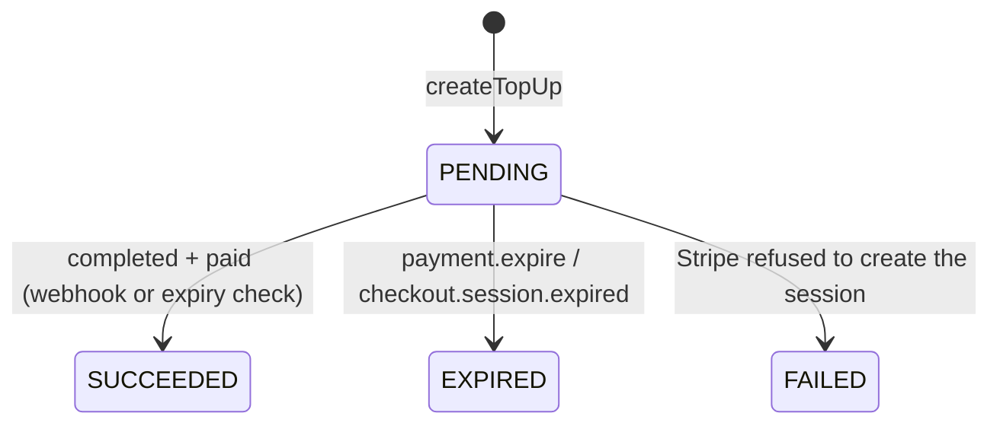

# Step 3 — Payments service

- **Where:** committed directly to `main`.

## Why

This is the first time money enters NexusPay from outside. Until now the only way to get a
balance was `seed`. A top-up goes through Stripe Checkout (test mode): the user pays on Stripe's
page, and Stripe tells us the outcome through a signed webhook. Three things can go wrong, and the
service is built around them:

- **Stripe repeats itself.** A webhook may arrive twice, late, or out of order (`expired` after
  `completed`), and `stripe events resend` replays it on purpose. Money must still move once.
- **The network fails halfway.** Our database and Stripe can't share a transaction. If the
  process dies between "payment row written" and "Stripe session created", no money may be lost or
  invented.
- **A payment races its own expiry.** An unpaid top-up must expire, but a customer who pays at
  minute 29:59 must still be credited.

`payments` owns the payment records and talks to Stripe. It never touches balances: it announces
`payment-succeeded` on Pulsar, and the wallet credits it in step 4.

## What changed

| Area                                  | Change                                                                                                                                                                             |
| ------------------------------------- | ---------------------------------------------------------------------------------------------------------------------------------------------------------------------------------- |
| `apps/payments` (new, port 3005)      | NestJS app, `payments` database (Drizzle): `payments`, `stripe_events`, `recon_issues`, `outbox`, `idempotency_keys`                                                               |
| GraphQL `/payments`                   | `createTopUp(input: { amount })` (`@Idempotent()`), `payment(id)`, `payments(first)`, behind `GqlAuthGuard`; schema printed to `apps/payments/schema.gql`                          |
| REST `POST /payments/webhooks/stripe` | Signature checked on the raw body (`rawBody: true`); `applyStripeEvent` in one transaction                                                                                         |
| RabbitMQ                              | Declares `commands` (topic), `payments.commands` (`payment.*`, retries, DLQ), delay buckets `delay.1m` / `delay.30m` / `delay.24h`; `PaymentCommandsConsumer` for `payment.expire` |
| Outbox                                | One relay, two publishers: `payment-succeeded` to Pulsar, `payment.expire` to RabbitMQ                                                                                             |
| Stripe                                | `stripe` 23.1.0 pinned, API version `2026-10-28.endive` pinned in the client                                                                                                       |
| Secrets                               | `apps/payments/.env.local` (gitignored, new `.env.local` rule) holds `STRIPE_SECRET_KEY` and `STRIPE_WEBHOOK_SECRET`; the committed `.env` has only non-secret defaults            |
| Scripts                               | `payments` in `npm start`; 3005 in `npm stop`                                                                                                                                      |

## How it works

### A payment's states

Every change is `UPDATE payments SET status = … WHERE id = $1 AND status = 'PENDING'`. A late or
repeated event updates zero rows and changes nothing. Check constraints keep the amount within
USD 1.00 to 1,000.00, the currency at `USD` and the status within the four values.

### `createTopUp`

1. **Validate.** The amount must be 100 to 100,000 minor units. The limit is USD 2,000 per user
   in any rolling 24 hours, counting PENDING and SUCCEEDED top-ups. A per-user advisory lock
   (`pg_advisory_xact_lock(3005, userId)`) stops two parallel requests from both passing the limit
   check.
2. **Transaction 1.** Insert the PENDING row, and in the same transaction put `payment.expire` in
   the outbox, addressed to the delay bucket (`delay.30m`; `PAYMENT_EXPIRY_BUCKET`). If the process
   dies right after the commit, the expiry still runs.
3. **Stripe, outside any transaction.** `checkout.sessions.create` with `unit_amount`, `metadata`
   and `client_reference_id` = the payment id, `success_url = APP_URL/wallet?topup=<id>`, and the
   idempotency key `checkout-session:<id>`, so a retried call gets the same session back.
   `expires_at` is 31 minutes: Stripe refuses less than 30 after it creates the session, and our
   clock starts first.
4. **Then.** On success, store the session id. If Stripe fails, mark the payment FAILED and return
   `PAYMENT_PROVIDER_UNAVAILABLE`.

What a crash leaves behind, at each point:

| Dies after               | State                          | What happens                                                          |
| ------------------------ | ------------------------------ | --------------------------------------------------------------------- |
| Transaction 1            | PENDING, no session            | The expiry command marks it EXPIRED; nobody got a Checkout URL        |
| Stripe created a session | PENDING, session id not stored | The same; the session at Stripe is unreachable and expires on its own |
| Session id stored        | Normal                         | Normal                                                                |

`@Idempotent()` makes a retried request (same `Idempotency-Key`) return the first answer instead
of creating a second payment.

### The webhook

`constructEvent(rawBody, signature, STRIPE_WEBHOOK_SECRET)` must succeed, otherwise the request
gets 400 and nothing is written. Then, in **one** transaction:

1. `INSERT INTO stripe_events (event_id) … ON CONFLICT DO NOTHING`. A second delivery of the same
   event inserts nothing and stops here (`duplicate: true`).
2. `checkout.session.completed` (or `async_payment_succeeded`) with `payment_status = 'paid'`
   locks the payment row and checks it:
   - **PENDING, same amount and currency, same session:** set SUCCEEDED and write
     `payment-succeeded` `{ paymentId, userId, amount, currency }` to the outbox, keyed by
     `userId`.
   - **Already SUCCEEDED:** nothing to do.
   - **Anything else:** a row in `recon_issues`, and no money moves. "Anything else" means
     already EXPIRED or FAILED, another amount or session, or an unknown payment. Phase 5 reports
     these issues.
3. `checkout.session.expired`: PENDING → EXPIRED.
4. Other types, and sessions without our `paymentId` (for example fixtures from `stripe
trigger`): stored, otherwise ignored.

### Expiry: Stripe first

`payment.expire` reaches `payments.commands` through the delay bucket, keeping its routing key.
The consumer asks Stripe to expire the session **before** touching the row:

- **Stripe confirms it expired:** nobody can pay it any more, so set EXPIRED.
- **Stripe refuses** ("only open sessions can be expired"): the consumer fetches the session.
  - Complete and paid: the customer paid at the last second. It settles the payment through the
    same path as the webhook, and the webhook later finds it SUCCEEDED.
  - Complete but unpaid (a delayed payment method): it waits for `async_payment_succeeded`.
- **Stripe is unreachable:** the consumer throws, and the command is retried after 5 s, 30 s and
  5 min, then goes to `payments.commands.dlq`.

The spec says the expiry should do nothing for a complete session and wait for the webhook. The
consumer settles it instead, on purpose: if the webhook never comes (`stripe listen` wasn't
running), the payment would stay PENDING for good, and the session fetched from Stripe with our
secret key is as trustworthy as the webhook. The lock and the `status = 'PENDING'` condition still
allow only one credit, whichever path comes first.

## How it was verified

- **`npx nx test payments`:** 23 tests. The real app (GraphQL over HTTP, the webhook with
  signatures made by the Stripe SDK, the outbox relay, and `payment.expire` through a real
  delay-bucket queue) runs against Testcontainers PostgreSQL and RabbitMQ. `delay.1m` waits 2 s in
  the test. `auth` and Pulsar are faked, and so is Stripe's Checkout API, by an in-memory copy of
  its session states (open → complete / expired, and refusing to expire a closed session).
  - **Acceptance 1:** a wrong secret, a missing header or a garbage signature gets 400, with no
    `stripe_events` row and the payment still PENDING.
  - **One credit:** the same `completed` event sent 11 times gives one SUCCEEDED and exactly one
    `payment-succeeded`, keyed by the user id.
  - **Acceptance 4:** `expired` after `completed` leaves it SUCCEEDED.
  - **Acceptance 5:** an unpaid top-up is EXPIRED after the bucket delay, and the session is
    expired at the fake Stripe.
  - **Acceptance 6:** paid without a webhook before the expiry fires gives SUCCEEDED with one
    event, and the late webhook adds nothing.
  - **Retries:** Stripe unreachable on the first expiry attempt; the retry 5 s later expires it.
  - **Recon:** paid after it expired → `paid_after_expired`; another amount → `amount_mismatch`;
    in both cases no event. A foreign session is stored and ignored.
  - **`createTopUp`:**
    - the Stripe call carries the expected parameters and idempotency key;
    - the expiry command is in the outbox;
    - 99 and 100,001 are refused with nothing written;
    - a number instead of a string is refused;
    - the $2,000 per 24 h limit holds, frees up when a top-up expires, and is per user;
    - Stripe down gives FAILED and `PAYMENT_PROVIDER_UNAVAILABLE`;
    - the same `Idempotency-Key` gives one payment.
  - **Queries:** `payment(id)` returns only the caller's payment; `payments` lists newest first.
  - **Schema:** `apps/payments/schema.gql` matches the printed schema.
- **Live, against the real Stripe test account, with `auth` and `payments` running and the expiry
  set to `delay.1m`:**
  - `createTopUp` of $50 returned a real `checkout.stripe.com` URL;
  - the same key returned the same payment, and 100,001 was refused;
  - after 60 s the payment was EXPIRED, and Stripe reported the session as `expired`, `unpaid`,
    with our `paymentId` in its metadata;
  - all `payments.commands` queues and the DLQ were empty.
- `npx nx affected -t lint test build`: green for all 19 affected projects.

The paid path against real Stripe (card 4242…, webhook through `stripe listen`) is step 5, once
the wallet credits it.

## Lessons

- **`ValidationPipe({ whitelist: true })` strips undecorated fields.** `CreateTopUpInput.amount`
  had only `@Field` and arrived as `undefined`, and the insert failed on a NOT NULL column. Every
  input field needs a class-validator decorator; this one got `@IsBigInt()`. The service also
  checks the type.
- **A test Stripe account still has a home currency.** This one settles in RON, and charging in
  USD works: Stripe converts on settlement. The amount Stripe reports back (`amount_total`) is in
  the charged currency, which is the one we compare.
- **Secrets need their own file when `.env` is committed.** Every `apps/*/.env` in this repo is
  in git, so the Stripe keys live in `apps/payments/.env.local`, gitignored. The app reads it
  first (`ConfigModule` `envFilePath`), so its values win over `.env`.
